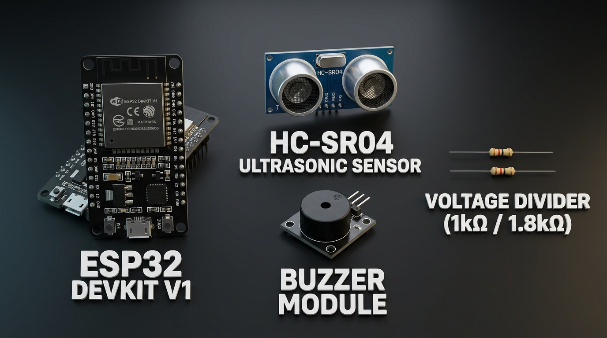
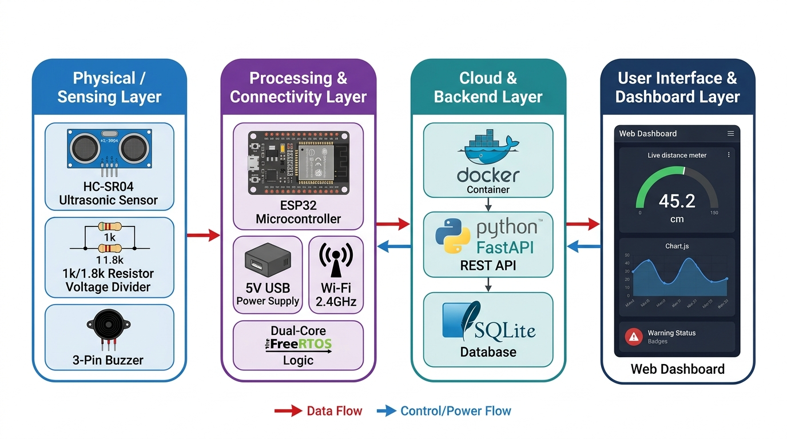
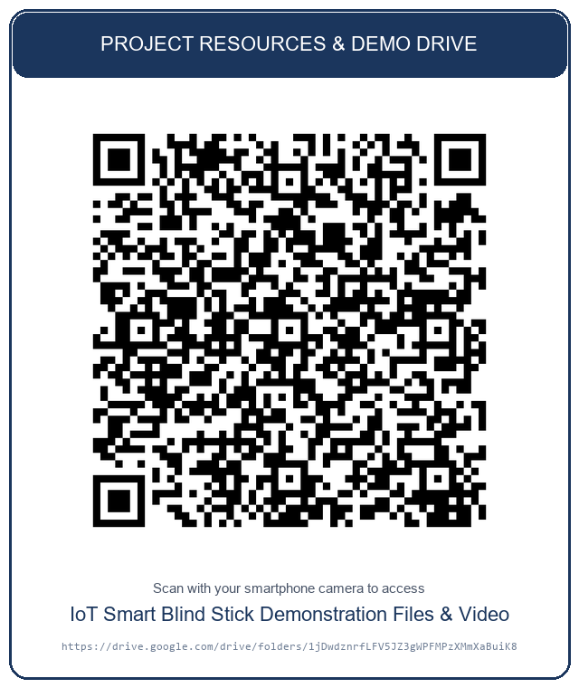

# SMART BLIND STICK WITH REAL-TIME OBSTACLE MONITORING AND CLOUD DASHBOARD SYSTEM

## 1. INTRODUCTION
Visual impairment presents severe challenges to independent mobility, spatial orientation, and personal safety. Visually impaired individuals face daily navigational hazards such as unexpected obstacles, walls, furniture, and dynamic barriers in their walking path. Traditional mobility aids, such as standard white canes, only detect obstacles upon direct physical contact and fail to anticipate hazards in advance or detect elevated obstacles at torso or head height. Furthermore, traditional canes provide no telemetry or status tracking to caregivers or remote monitoring systems.

To overcome these critical limitations, this project proposes an IoT-based Smart Blind Stick with Real-Time Obstacle Monitoring and Notification System. The system integrates an HC-SR04 ultrasonic sensor with a calibrated voltage divider and an intermittent acoustic buzzer module connected to an ESP32 microcontroller. The stick continuously measures obstacle proximity ahead of the user and produces frequency-modulated acoustic beeps that increase in repetition rate as obstacles approach, warning the user without inducing auditory fatigue. Simultaneously, the ESP32’s dual-core architecture enables Core 0 to transmit real-time telemetry over Wi-Fi via HTTP POST to a containerized FastAPI backend, persisting records in an SQLite database and streaming live updates to a responsive web dashboard. This solution delivers an affordable, reliable, non-blocking, and accessible assistive IoT device.

---

## 2. AIM OF THE PROJECT
The main aim of this project is to design, develop, and implement an IoT-enabled smart blind stick that continuously detects obstacles ahead using ultrasonic ranging, provides non-blocking intermittent acoustic alerts to the user, and transmits live telemetry to a containerized cloud backend and real-time dashboard for remote monitoring and logging.

---

## 3. OBJECTIVES
- To measure real-time obstacle distance accurately within a 2 cm to 400 cm range using an HC-SR04 ultrasonic distance sensor.
- To protect the 3.3V ESP32 microcontroller from 5V echo pulses using a dedicated 1 kΩ / 1.8 kΩ resistor voltage divider (yielding a safe 3.21V logic level).
- To produce intuitive, non-fatiguing acoustic alerts using an intermittent buzzer sequencer that varies beep frequency according to proximity while keeping each beep duration strictly at ~60 ms (never sounding continuously).
- To execute non-blocking obstacle sensing and warning on ESP32 Core 1 while asynchronously transmitting telemetry over Wi-Fi on Core 0 via FreeRTOS, ensuring network delays never compromise user safety.
- To develop a containerized FastAPI backend with persistent SQLite storage for logging timestamped obstacle telemetry.
- To create a responsive, real-time web dashboard displaying live distance gauges, Chart.js time-series graphs, buzzer rhythm simulation, and connection health alerts.

---

## 4. EXISTING SYSTEM
The traditional and existing methods for visually impaired navigation rely predominantly on mechanical white canes, tactile guide canes, or basic standalone electronic buzzers.

### Disadvantages:
- **Physical Contact Requirement:** Traditional canes only detect obstacles after physical impact has already occurred, risking falls or injuries from elevated or sharp objects.
- **Auditory Fatigue & Signal Masking:** Naive electronic canes emit continuous, harsh buzzing when obstacles are close, causing ear fatigue and masking essential environmental sounds like vehicle horns, traffic, and human speech.
- **Single-Core Freezing:** Basic microcontrollers freeze sensor scanning during Wi-Fi reconnects or HTTP requests, leaving the user unprotected during network stalls.
- **Lack of Remote Telemetry:** No centralized logging, cloud storage, or dashboard exists to monitor device health, navigation events, or safety history.
- **Inability to Detect Distant Hazards:** Manual tapping provides zero advance warning of approaching hazards beyond arm’s reach.

---

## 5. PROPOSED SYSTEM
The proposed system introduces an IoT-based smart assistive navigation stick that combines local real-time acoustic obstacle avoidance with containerized cloud telemetry. The ESP32 DevKit V1 reads time-of-flight pulses from an HC-SR04 sensor, applies a 5-sample median noise filter and a 2 cm hysteresis buffer, and determines the obstacle warning zone (Clear, Warning, Caution, Danger, or Very Close).

An intermittent buzzer algorithm triggers short 60 ms acoustic pulses with variable silence intervals (from 800 ms down to 150 ms) to give intuitive spatial cues. In the background, a dedicated FreeRTOS task on Core 0 packages distance readings into structured JSON payloads and dispatches them via HTTP POST to a containerized FastAPI backend. The backend validates the data, stores records in an SQLite database, and serves a modern glassmorphic dashboard with live proximity indicators, time-series charts, and offline alerts. This architecture ensures complete user safety locally while offering comprehensive remote monitoring.

---

## 6. SYSTEM ARCHITECTURE
The system architecture consists of two integrated operational tiers: the **Device (Edge) Tier** and the **Backend / Cloud Tier**.

```
+-----------------------------------------------------------------------------------------+
|                                1. DEVICE (EDGE) TIER                                   |
|                                                                                         |
|   +-----------------------+                    +------------------------------------+   |
|   |  HC-SR04 Ultrasonic   |                    |        3-Pin Buzzer Module         |   |
|   |  Sensor (5V VCC, GND) |                    |       (GPIO 19, Active-LOW)        |   |
|   +-----------------------+                    +------------------------------------+   |
|       | TRIG (GPIO 5)  ^ ECHO (5V Pulse)                           ^ Signal             |
|       |                |                                           |                    |
|       |         +---------------+                                  |                    |
|       |         |Voltage Divider| (1kΩ / 1.8kΩ)                    |                    |
|       |         +---------------+                                  |                    |
|       v                v 3.21V Safe Logic                          |                    |
|   +---------------------------------------+   +-------------------------------------+   |
|   |         ESP32 Core 1 (Real-Time)      |   |       ESP32 Core 0 (Background)     |   |
|   |  - 60 ms Ultrasonic Scan Loop         |   |  - FreeRTOS Background Task         |   |
|   |  - 5-Sample Median Noise Filter       |   |  - Wi-Fi Station Mode               |   |
|   |  - 2 cm Hysteresis Zone Buffer        |   |  - Atomic Sensor State Snapshot     |   |
|   |  - Intermittent Beep Sequencer        |   |  - HTTP POST JSON Ingestion (~1.5s) |   |
|   +---------------------------------------+   +-------------------------------------+   |
+-----------------------------------------------------------------------------------------+
                                      │
                                      │ Wi-Fi 802.11 b/g/n (HTTP POST)
                                      ▼
+-----------------------------------------------------------------------------------------+
|                            2. BACKEND & CLOUD TIER                                      |
|                                                                                         |
|   +---------------------------------------------------------------------------------+   |
|   |  Docker Container: smart-blind-stick-backend (Port 8000)                        |   |
|   |                                                                                 |   |
|   |   +-------------------------+            +----------------------------------+   |   |
|   |   |     FastAPI / Uvicorn   |            |       SQLite Database Engine     |   |   |
|   |   |  - POST /api/readings   | ---------> |  - sensor_readings table         |   |   |
|   |   |  - GET  /api/readings   |            |  - Persistent Host Storage       |   |   |
|   |   |  - GET  /api/latest     |            |    ./data/sensor_readings.db     |   |   |
|   |   |  - GET  /api/health     |            +----------------------------------+   |   |
|   |   +-------------------------+                                                   |   |
|   |                │                                                                |   |
|   |                ▼                                                                |   |
|   |   +-------------------------------------------------------------------------+   |   |
|   |   |                     Real-Time Web Dashboard                             |   |   |
|   |   |  - Proximity Hero Card & Warning Badge (CLEAR to VERY CLOSE)            |   |   |
|   |   |  - Buzzer Equalizer Cadence Simulation (150 - 800 ms rhythm)            |   |   |
|   |   |  - Chart.js Rolling Time-Series Graph                                   |   |   |
|   |   |  - Historical Audit Table & Disconnection/Stale Data Alerts             |   |   |
|   |   +-------------------------------------------------------------------------+   |   |
|   +---------------------------------------------------------------------------------+   |
+-----------------------------------------------------------------------------------------+
```

### 6.1 Hardware Components
- **ESP32 DevKit V1:** Dual-core 240 MHz Xtensa microcontroller with built-in Wi-Fi and FreeRTOS task scheduling.
- **HC-SR04 Ultrasonic Distance Sensor:** Emits 40 kHz ultrasonic waves to gauge distance from 2 cm to 400 cm.
- **3-Pin Buzzer Module:** Active buzzer providing intermittent auditory warning tones (Active-LOW, GPIO 19).
- **Voltage Divider Resistors (1 kΩ & 1.8 kΩ):** Protects ESP32 GPIO 18 by safely stepping down the 5.0V echo pulse to ~3.21V.
- **Prototyping Breadboard & Jumper Wires:** Enables secure, solderless circuit interconnections.
- **Micro-USB Power Cable / Power Bank:** Powers the ESP32 and attached peripherals via the 5V VIN rail.

### 6.2 Software Components
- **PlatformIO / Arduino Framework:** Embedded C++ development environment compiling firmware for ESP32.
- **FreeRTOS:** Real-time operating system managing dual-core task isolation between sensing and networking.
- **Python FastAPI + Uvicorn:** High-performance asynchronous REST API backend validating and serving telemetry.
- **SQLite Database:** Lightweight, zero-maintenance relational database with persistent storage.
- **Docker & Docker Compose:** Containerized environment isolating backend runtime and persistent volumes.
- **Web Dashboard (HTML5, Modern CSS, Vanilla JS, Chart.js):** Real-time web visualization client.

---

## 7. WORKING PRINCIPLE
1. **Initialization:** On boot, the ESP32 configures GPIO pins, silences the buzzer, initializes the median filter buffer, and starts the FreeRTOS telemetry task on Core 0 while Core 1 begins the sensing loop.
2. **Data Acquisition:** The ESP32 triggers a 10 µs pulse on GPIO 5 (`TRIG`). The HC-SR04 emits an 8-cycle 40 kHz ultrasonic burst and pulls GPIO 18 (`ECHO`) HIGH for the round-trip flight duration.
3. **Voltage Protection & Calculation:** The 5V echo pulse passes through the 1 kΩ / 1.8 kΩ voltage divider, delivering a safe 3.21V logic signal to GPIO 18. Distance is computed using the speed of sound:
   $$\text{Distance (cm)} = \frac{\text{Duration (µs)} \times 0.0343}{2}$$
4. **Noise Filtering & Threshold Classification:** A 5-sample circular median filter removes acoustic spikes. A 2 cm hysteresis margin categorizes distance into defined warning zones:
   - **Clear (> 100 cm):** Buzzer OFF (Silent).
   - **Warning (61 – 100 cm):** Slow beep every 800 ms.
   - **Caution (31 – 60 cm):** Medium beep every 450 ms.
   - **Danger (15 – 30 cm):** Fast beep every 250 ms.
   - **Very Close (< 15 cm):** Rapid pulse every 150 ms (each pulse strictly 60 ms).
   - **Unknown / Timeout:** Buzzer OFF (Safe state, avoiding false clear assumptions).
5. **Dual-Core Data Transmission:** An atomic snapshot of distance and status is passed from Core 1 to Core 0 via `portENTER_CRITICAL`. Core 0 serializes the reading into JSON:
   ```json
   {
     "device_id": "blind-stick-01",
     "distance_cm": 45.2,
     "status": "valid"
   }
   ```
   and transmits it via HTTP POST to `/api/readings` every 1.5 seconds without blocking the buzzer loop.
6. **Monitoring & Visualization:** The FastAPI backend validates the payload, saves it to SQLite, and streams the data to the browser dashboard where distance gauges, time-series curves, buzzer rhythm bars, and audit logs update in real time.

---

## 8. CONNECTION DETAILS

| Component | Pin | Type | ESP32 Pin | Voltage |
|---|---|---|---|---|
| **HC-SR04** | VCC | Power | VIN | 5.0V |
| **HC-SR04** | GND | Ground | GND | 0V |
| **HC-SR04** | TRIG | Digital Output (from ESP32) | GPIO 5 (D5) | 3.3V |
| **HC-SR04** | ECHO | Digital Input (via Divider) | GPIO 18 (D18) | 3.21V (Stepped down from 5V) |
| **Voltage Divider R1** | Input Leg | Passive Resistor (1 kΩ) | Connected to HC-SR04 ECHO | 5.0V |
| **Voltage Divider Node**| Junction | Intermediate Node | GPIO 18 (D18) | 3.21V |
| **Voltage Divider R2** | Ground Leg| Passive Resistor (1.8 kΩ) | ESP32 GND | 0V |
| **Buzzer Module** | VCC | Power | VIN / 3.3V | 3.3V – 5.0V |
| **Buzzer Module** | GND | Ground | GND | 0V |
| **Buzzer Module** | I/O (Signal)| Digital Output (from ESP32) | GPIO 19 (D19) | 3.3V (Active-LOW) |

---

## 9. CLOUD & CONTAINER HOSTING
The backend system is designed for containerized deployment on any local server, college lab PC, or cloud virtual machine (e.g., Azure VM, AWS EC2, or DigitalOcean droplet).

- **Cloud / Local Host:** Ubuntu Linux or Windows host with exposed port `8000`.
- **Docker Setup:** Production-grade `Dockerfile` using Python 3.11-slim, packaging FastAPI, Uvicorn, and Pydantic.
- **Docker Compose Deployment:** Single command orchestration (`docker compose up -d --build`) managing auto-restart and port binding.
- **Persistent Data Management:** SQLite database volume bind-mounted to `./data:/app/data`, ensuring telemetry history is never lost during container rebuilds or system reboots.
- **Health Monitoring:** Automated container health checks pinging `/api/health` every 30 seconds to ensure high availability.

---

## 10. RESULTS
The implemented system successfully:
- Accurately measures obstacle distances in real time between 2 cm and 400 cm with sub-centimeter resolution.
- Modulates acoustic warning cadence from 800 ms down to 150 ms without ever sounding continuously, preventing ear fatigue.
- Guarantees zero audio stuttering or sensor pause during Wi-Fi transmissions through FreeRTOS dual-core task isolation.
- Validates and stores all telemetry readings in a persistent SQLite database.
- Renders an interactive web dashboard with real-time distance gauge, Chart.js time-series curve, buzzer cadence visualizer, and audit table.
- Displays instantaneous warning banners if Wi-Fi drops or sensor telemetry becomes stale (> 5 seconds).

---

## 11. ADVANTAGES
- **Non-Fatiguing Acoustic Safety:** Fixed 60 ms pulse duration prevents continuous shrill noise and preserves environmental situational awareness.
- **Dual-Core Reliability:** Core 1 guarantees uninterrupted local obstacle detection even if Wi-Fi, the backend, or the internet fails.
- **Hardware Circuit Safety:** Resistor voltage divider eliminates 5V overvoltage risks, safeguarding the 3.3V ESP32 microcontroller.
- **Containerized & Scalable:** Dockerized FastAPI architecture simplifies multi-device support and deployment on local or cloud hosts.
- **Low Cost & Energy Efficient:** Built using standard, widely accessible components suitable for mass production.
- **Zero-Latency Visualization:** Real-time web dashboard gives remote caregivers live situational feedback.

---

## 12. APPLICATIONS
- **Personal Assistive Navigation:** Daily indoor and outdoor mobility assistance for visually impaired individuals.
- **Elderly Care & Fall Prevention:** Proximity awareness and obstacle warning for seniors in homes or assisted living facilities.
- **Rehabilitation Centers:** Mobility training and spatial adaptation tools for patients recovering from vision loss.
- **Industrial Facility Navigation:** Low-visibility navigation aid for workers in smoke-prone, dusty, or unlit environments.
- **Smart Campus & Healthcare Monitoring:** Telemetry tracking for institutional accessibility management.

---

## 13. FUTURE ENHANCEMENTS
- **Multi-Sensor 3D Array:** Integrating a downward-angled sensor for steps/potholes and an upward-angled sensor for overhead hazards.
- **Cellular (4G/LTE-M) or LoRaWAN Connectivity:** Enabling long-range telemetry tracking outdoors beyond local Wi-Fi range.
- **GPS Location & Emergency SOS Button:** Adding a panic button and GPS module to transmit emergency SMS location coordinates to caregivers.
- **Haptic Grip Feedback:** Supplementing the buzzer with an eccentric rotating mass (ERM) vibration motor for deaf-blind users.
- **Solar / Li-ion Rechargeable Power:** Adding an 18650 Li-ion cell with a TP4056 charging module and solar harvesting for all-day mobile use.

---

## 14. CONCLUSION
The Smart Blind Stick with Real-Time Obstacle Monitoring and Cloud Dashboard System delivers an intelligent, practical, and life-enhancing assistive IoT solution. By combining real-time ultrasonic ranging, intermittent acoustic safety alerts, and dual-core FreeRTOS processing on the ESP32 with a containerized FastAPI backend and persistent SQLite database, the project achieves an optimal balance between critical user safety and modern cloud observability. The system eliminates the hazards of traditional white canes and establishes a solid, scalable framework for next-generation assistive technology.

---

## 15. PROJECT DESIGN

### Data Flow:
1. **HC-SR04 Sensor → Voltage Divider → ESP32 Core 1:** Ultrasonic burst echoes determine distance; 1 kΩ / 1.8 kΩ divider protects GPIO 18; Core 1 applies median filtering and drives the buzzer on GPIO 19.
2. **ESP32 Core 1 → Shared Memory → ESP32 Core 0:** Atomic sensor snapshot passed across cores via FreeRTOS critical sections.
3. **ESP32 Core 0 → Wi-Fi (HTTP POST) → Docker FastAPI Backend:** JSON payload transmitted to `/api/readings` every ~1.5s.
4. **FastAPI Backend → SQLite Database (`./data/sensor_readings.db`):** Validated readings persisted in structured relational storage.
5. **FastAPI Backend → Real-Time Web Dashboard:** Serves live distance indicators, Chart.js time-series curves, buzzer rhythm visualizers, and audit logs to client browsers.

---

## 16. HARDWARE COMPONENTS



*Figure 16.1: Key Hardware Components — ESP32 DevKit V1, HC-SR04 Ultrasonic Distance Sensor, 3-Pin Buzzer Module, and 1 kΩ / 1.8 kΩ Resistor Voltage Divider.*

---

## 17. BLOCK DIAGRAM



*Figure 17.1: End-to-End System Block Diagram — 4-Layer Architecture showing Physical Sensing Layer, ESP32 Processing & Connectivity Layer, Containerized Cloud Backend Layer, and Real-Time User Interface & Dashboard Layer.*

---

## 18. PROJECT DEMONSTRATION & DRIVE QR CODE

Scan the QR code below with any smartphone camera or QR reader to access the official Google Drive repository containing demonstration videos, photos, and project assets:



*Figure 18.1: Scan to open Google Drive Project Folder:* [https://drive.google.com/drive/folders/1jDwdznrfLFV5JZ3gWPFMPzXMmXaBuiK8?usp=drive_link](https://drive.google.com/drive/folders/1jDwdznrfLFV5JZ3gWPFMPzXMmXaBuiK8?usp=drive_link)


